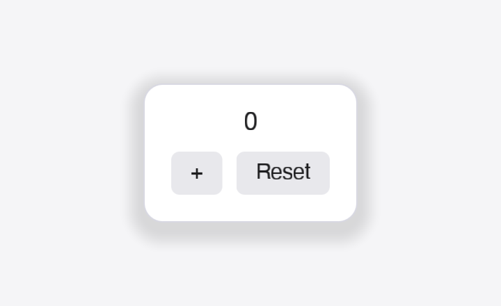
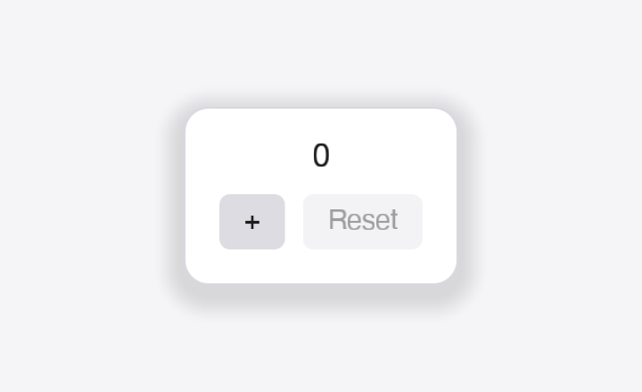
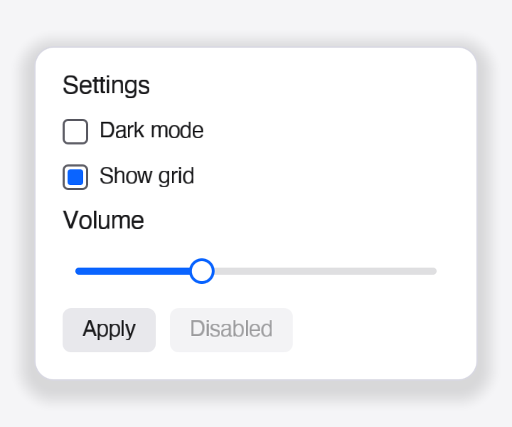
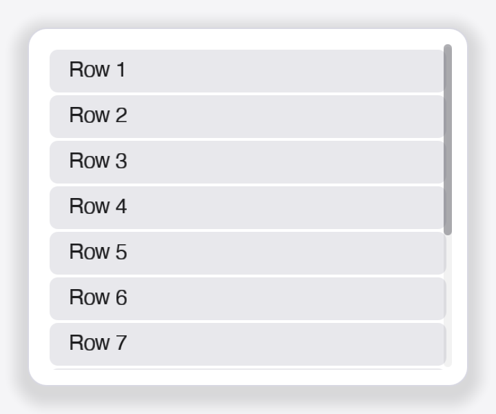
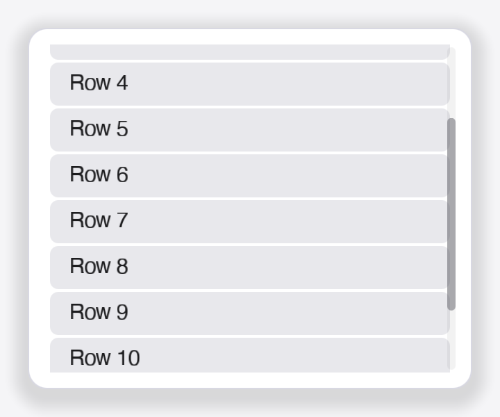
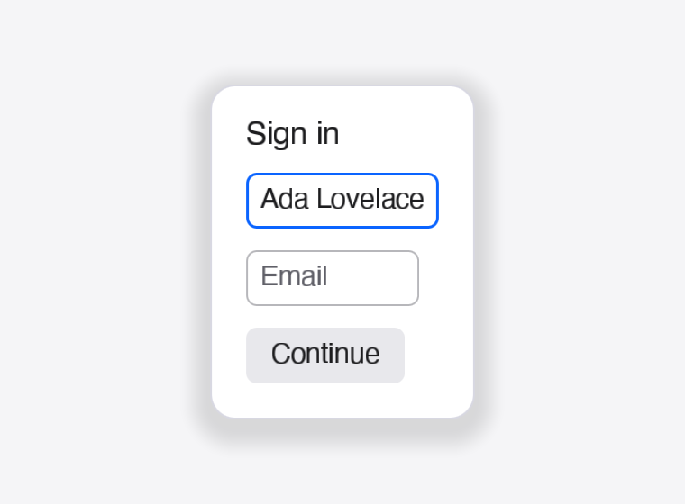
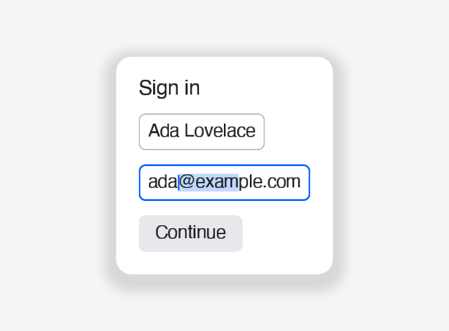
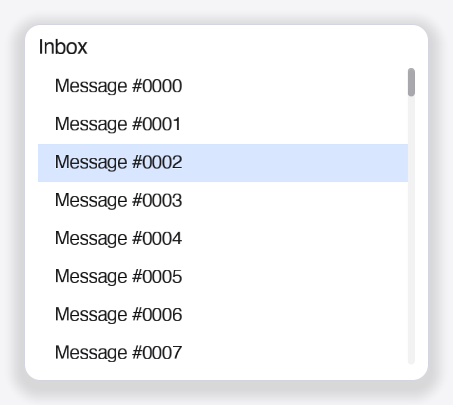
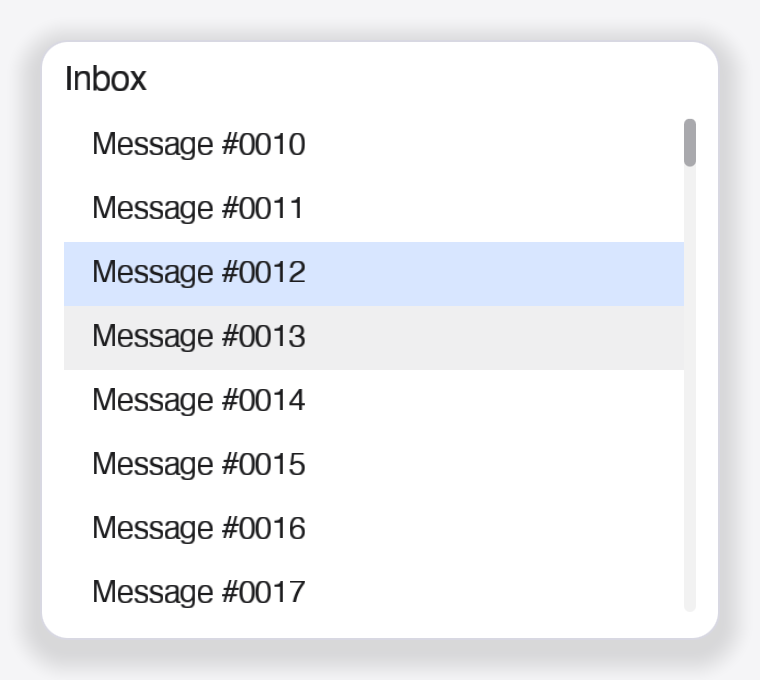

# FerriticUI

基于 [`blade`](https://github.com/kvark/blade) 的**纯静态保留模式** Rust GUI 库(C′ 扁平静态树路线)。

> 当前状态:**v6 骨架**:`ui!` 宏生成的扁平静态树、SDF 圆角/边框/**软阴影**、系统字体文本
> (DPI 感知)、Label/Button/Checkbox/TextInput/Slider/List/Panel/Center/Scroll、scissor 裁剪与
> 滚轮、文本编辑(光标/选区/剪贴板/IME 预编辑)、虚拟化列表、命中/消息/Tab 焦点/滚动/编辑测试、
> 离屏快照 golden 回归(逐字节 + SSIM 容差)。
> **Redox 路径**:`ferritic-soft`(纯 CPU 光栅化)+ `ferritic-orbital`(orbclient 窗口)+
> `ferritic-term`(ransid 终端 + PTY/ion);`ferritic-demo` / `ferritic-term` 可在主机
> (orbclient 的 SDL2 后端)开窗运行,并已在 Redox 测试镜像中验证。

| Counter | 交互状态 | Settings gallery |
|---|---|---|
|  |  |  |

| Scroll list(顶部) | Scroll list(滚动后) |
|---|---|
|  |  |

| 表单(焦点 + 光标) | 表单(选区) |
|---|---|
|  |  |

| List(1000 行,虚拟化) | List(滚动 + 选中 + hover) |
|---|---|
|  |  |

## 运行

```bash
# 打开窗口(关窗退出)
./scripts/cargo.sh run -p ferritic --example counter

# 不开窗口:离屏渲染一帧,写出 PNG 到临时目录
./scripts/cargo.sh run -p ferritic --example counter -- --snapshot

# 冒烟:开窗,渲染若干帧后自动退出(用于 CI/无人值守)
FERRITIC_EXIT_AFTER_MS=1200 ./scripts/cargo.sh run -p ferritic --example counter

# 无 GPU:用 ferritic-soft(纯 CPU)渲染同一 counter 场景,写出 PPM 到临时目录
cargo run -p ferritic-soft --example counter_snapshot

# Redox 栈:ferritic-orbital 窗口 + ferritic-soft 渲染(主机上 orbclient 走 SDL2)
cargo run -p ferritic-demo

# 不开窗口:上面的 demo 直接输出 PPM 快照
cargo run -p ferritic-demo -- --snapshot

# Redox 终端:PTY 里跑 $SHELL(或 --shell /usr/bin/ion),ransid 解析 + 软渲染
cargo run -p ferritic-term
```

首次构建会编译 vendored 的 blade + naga(约 20-60s)。工具链 Rust 1.93,macOS arm64 已验证。

## 实现清单

已实现(全部通过 `cargo check/build` 与测试):

- **工作区**:vendor 的 `blade-ferritic` 集成分支(基于 main `30c94eb` + D3D12 后端 + MIT 依赖策略,rev `4c7b695`);blade 依赖的 `naga`/`naga-types` fork(`kvark/wgpu` rev `9964733`)也 vendored 在 `vendor/wgpu-naga`(内联 workspace 字段),`Cargo.lock` 中已无 git 依赖。crates:`ferritic-core` / `ferritic-text` / `ferritic-blade` / `ferritic-soft` / `ferritic-orbital` / `ferritic-winit` / `ferritic-macros` / `ferritic` / `ferritic-demo`。
- **静态模型**:`ui!` 生成扁平 `struct`(字段即节点)、私有 `enum Node`、编译期子节点/焦点表、每个 pass 的静态 `match`;`App::update` 唯一根消息;无运行时树、无 diff、无反射。
- **布局**:Column / Row / Center / Panel / Scroll(无限高度测量、滚动 + clamp、滚动条);子节点 clamp 与 child constraints。
- **事件**:命中测试、hover/pressed、点击聚焦、Tab 焦点顺序、滚轮(叶子优先 + Scroll 冒泡)、TextInput 编辑键、Ctrl 修饰键。
- **渲染**:blade swap chain + 离屏 readback;SDF 圆角/边框/软阴影;按图元+scissor 分批;系统字体 → swash 光栅化 → A8 字形图集(DPI 感知、像素吸附、半 texel 内缩)。
- **文本编辑**:光标/选区/横向滚动、Home/End/方向键/Shift 扩选、Ctrl+A/C/X/V 剪贴板、IME 预编辑/提交、焦点同步 `set_ime_allowed`/`set_ime_cursor_area`。
- **控件**:Label、Button(hover/pressed/disabled/文本对齐)、Checkbox、TextInput、Slider(拖拽/键盘)、List(1000 行虚拟化)、Panel(背景/边框/阴影)、Center、Scroll。
- **验证**:11 个交互测试(headless,无需 GPU)+ 9 张离屏快照 golden(`scripts/check.sh`,逐字节或 SSIM ≥ 0.95);6 个示例窗口冒烟可运行。
- **软渲染(Redox 路径)**:`ferritic-soft`,纯 Rust CPU 光栅化器,规则与 blade 着色器一致(SDF 圆角/边框、软阴影、A8 字形线性采样、相同 scissor 与混合因子);同机同字体下与 blade GPU 渲染逐像素对比 **SSIM 0.9996**(平均通道误差 0.04)。
- **Orbital 平台(Redox 路径)**:`ferritic-orbital`,orbclient 窗口和事件循环,把 `ferritic-soft` 的 RGBA8 直接写入窗口缓冲;键/鼠标/滚轮/焦点/缩放/剪贴板映射与 winit 层一致,并提供 `run_polling`/`App::tick` 供 PTY、socket 等轮询型应用使用。`ferritic-demo` 在主机上经 orbclient 的 SDL2 后端运行,并已在 redox 仓库的 `recipes/gui/ferriticui` + `CONFIG_NAME=ferriticui` 镜像中启动成功:Orbital 窗口正常显示,点击 `+` 计数从 0 变为 1;recipe 还会安装 Orbital launcher 条目(`/usr/share/ui/apps/65_ferriticui`)。
- **终端(Redox 路径)**:`ferritic-term`,ransid 终端仿真 + `/dev/ptmx` PTY 里启动 ion,键盘输入/ANSI 颜色/光标/窗口缩放均可用;已在 Redox 测试镜像中验证 `echo hi`(输出与回显正常),并注册为 launcher 的 `Terminal`。v0 暂无 scrollback、选区/复制、鼠标上报。

暂未实现(后续方向):desktop launcher/`.desktop` 集成、多行 `TextArea`、图标/菜单/弹窗/Tooltip、Tabs/ProgressBar/滚动条拖拽、无障碍(accesskit)、多窗口与设计器代码生成。

## 结构

```text
vendor/blade-ferritic/    自建集成分支:D3D12 后端 + MIT 依赖策略(rev 4c7b695,见 vendor/blade-ferritic.rev)
vendor/wgpu-naga/         blade 使用的 naga + naga-types fork(rev 9964733,见 vendor/wgpu-naga.rev)
crates/ferritic-core/     几何/主题/布局/Scene/事件/App·StaticUi,以及全部内置控件
crates/ferritic-text/     系统字体 + swash → A8 字形图集(DPI 感知;整形引擎暂未接入)
crates/ferritic-blade/    blade 渲染器:SDF 圆角/边框/软阴影、字形图集、批次+scissor、swap chain/离屏快照
crates/ferritic-soft/     纯 Rust CPU 光栅化器:同一场景 → RGBA8(Redox/Orbital 路径,无 GPU 依赖)
crates/ferritic-orbital/  orbclient 平台层:Orbital 窗口/事件循环 + 软渲染显示
crates/ferritic-demo/     Redox 演示程序:counter 窗口 + `--snapshot` 无显示模式
crates/ferritic-term/     终端:ransid 仿真 + PTY/ion + ferritic-soft 渲染(Redox)
crates/ferritic-winit/    winit 0.30 平台层:窗口/输入/DPI/IME/焦点/剪贴板、事件驱动重绘(空闲零帧)
crates/ferritic-macros/   ui! 过程宏:扁平 struct + Node 枚举 + 每个 pass 的静态分派
crates/ferritic/          facade 与 examples(counter / counter_manual / widgets / scroll / form / list)
scripts/                  cargo.sh(离线 CARGO_HOME)、check.sh(测试+golden)、ssim.py、update-blade.sh、run-windows.ps1
docs/implementation/      vendor/blade-ferritic 的组织说明(分支拓扑、更新流程、许可证现实)
```

### `ui!`:C′ 扁平静态树

```rust
ui! {
    msg = Msg;
    struct CounterUi {
        Center(padding: 24.0) {
            card: Panel(padding: 20.0, background: Color::WHITE, radius: 14.0) {
                value: Label(text: "0"),
                inc: Button<Msg>(text: "+", on_click: Msg::Increment),
            }
        }
    }
}
```

生成的形状:**节点 = 扁平 struct 字段**(具名字段可直接 `self.ui.value.set_text(..)`),树形是私有
`enum Node` + 编译期 `const` 子节点/焦点表,每个 pass(measure/arrange/paint/hit/event/theme/focus)
是一段生成的 `match`;布局状态是 `[NodeMeta; N]` 数组;消息只回唯一根 `App::update`。没有运行时
节点图、没有 diff、没有反射/属性系统。属性映射:`prop: value` → `widget.prop = value.into()`,
`on_*: value` → `Some(value)`;控件类型显式写消息泛型(如 `Button<Msg>`)。

### 渲染与文本

- blade `Bgra8Unorm` 未标记 sRGB surface(与 FerroUI.Blade 的结论一致),着色器直接输出 sRGB 值、按 sRGB 混合;
- 实心图元是一个 **SDF 圆角矩形着色器**:每个四边形携带 center/half_size/radii/fill/border,片元里 `sdRoundedBox` + `fwidth` 解析 AA,边框是内外距离的差;没有 tessellation、没有 MSAA;
- **软阴影**是同一个着色器的第二种模式:四边形按 blur 外扩,片元用 smoothstep 在 `0..blur` 距离上衰减,`Panel` 的 `shadow_blur/shadow_color/shadow_offset_*` 直接映射;
- CPU 变换到 NDC,按"图元种类 + 裁剪矩形"分批:同一批一次 draw,裁剪用 `set_scissor_rect`(Rectangle scissor),批内保持绘制顺序;
- 字形四边形吸附到物理像素网格 + 半 texel UV 内缩,避免图集双线性采样发糊;
- 文本用系统字体(Helvetica)+ swash 光栅化,按 DPI 缩放(Retina 2x 清晰),A8 图集经 `copy_buffer_to_texture` 上传;
- 离屏快照:渲染到 texture → `copy_texture_to_buffer` → RGBA PNG,无需显示器,是后续快照回归测试的基础。

## 验证

```bash
./scripts/check.sh
# == build ==  cargo build --workspace --examples
# == tests ==  cargo test -p ferritic(命中/消息/Tab 焦点)
# == snapshots ==  九张离屏快照:先逐字节比较,不同则要求 SSIM ≥ 0.95
                  失败时用 --bless 重新生成 golden
```

## 下一步

1. 把 D3D12 接入 blade 的 HAL traits/backend selection,并在 Windows 上验证 `d3d12` 示例与 FerriticUI 渲染;
2. 给 blade-ferritic 加 CI:`./scripts/update-blade.sh --check`、Windows `cargo check/test --features d3d12`、`cargo-deny` 许可证门禁;
3. 多行文本输入(`TextArea`):换行/软换行/上下移动;
4. 图标(预光栅化图集)、Menu/Popup/Tooltip、Tabs/ProgressBar/滚动条拖拽;无障碍(accesskit)。

## 调研文档(为什么是这个设计)

- [`docs/research/static-retained-gui-api.md`](docs/research/static-retained-gui-api.md):主报告(定义、生态、四种 API 形态、C′ 设计、Blade 渲染方案、FerroUI 复用清单、路线图)
- [`notes/static-retained-api.md`](notes/static-retained-api.md):GUI 框架 API 形态调研
- [`notes/ferroui-blade-audit.md`](notes/ferroui-blade-audit.md):FerroUI/Blade 后端的动态机制与复用审计
- [`notes/blade-ui-engine-research.md`](notes/blade-ui-engine-research.md):blade 上的 2D 引擎调研

## 工具链说明

- `.cargo/config.toml` 打开 `offline`,并使用工作区内的 `.cargo-home`(已合并本机 cargo 缓存与 FerroUI 的 blade/naga git 缓存,gitignore 忽略)。`scripts/cargo.sh` 会自动设置 `CARGO_HOME`;换机器时需要重建该缓存(blade 的 naga 是 git fork,`cargo vendor` 或联网一次)。
- `vendor/blade-ferritic/` 是 `../blade` 仓库里的长期集成分支:D3D12 后端(Windows-only feature `d3d12`)+ 去掉可避免 Apache-2.0-only 链的 winit 特性配置。pin 在 `vendor/blade-ferritic.rev`;更新用 `./scripts/update-blade.sh`(校验用 `--check`)。
- FerriticUI 的 `winit` 采用同一套 `default-features = false` 配置(去掉 `ab_glyph` 链);`ferritic-blade` 透传 `d3d12` feature,但 D3D12 尚未接入 blade 的 HAL,当前渲染仍走 Metal/Vulkan。
- 许可证现状与"严格 MIT-only 不可行"的原因(winit/codespan-reporting 是 Apache-2.0-only)记录在 [`docs/implementation/blade-ferritic.md`](docs/implementation/blade-ferritic.md)。
- Windows 远程验证(2026-11,rustc 1.99 msvc):`cargo build/test` 通过;blade-ferritic 的 D3D12 后端 49 个 lib 测试 + probe/smoke/compute/render/mesh/texture/wgsl/raytracing 示例全部通过(需设置 `BLADE_DXC_PATH` 到 Windows SDK 的 `dxcompiler.dll`)。GUI 也已在 Windows 上实际渲染验证(counter/widgets 窗口 + 全部 9 张快照):机器上旧的 AMD 集显 Vulkan ICD 会让 loader 返回 `VK_ERROR_INCOMPLETE`,用 `scripts/run-windows.ps1`(自动选择 NVIDIA ICD)即可运行;截图在 `docs/images/windows-*.png`,详见上面的组织说明文档。
